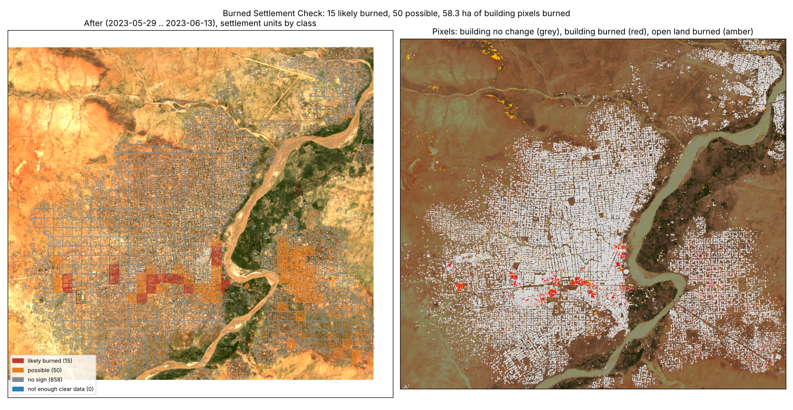
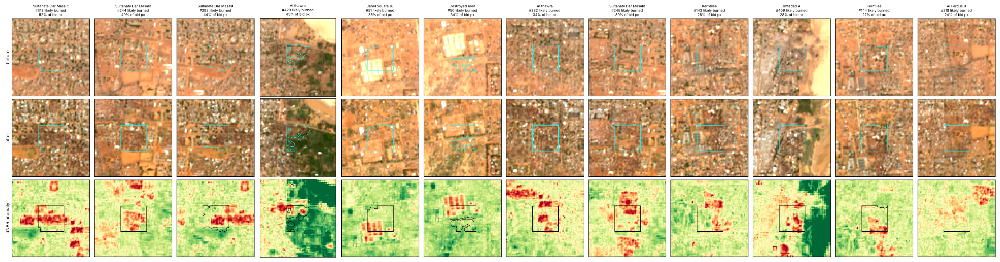

# Burned Settlement Check (`burncheck`) v0.1

Give it Sentinel-2 images from before and after an event and a set of building footprints. It returns **one row per village or town block saying whether its buildings show new burn scars**, how much of the built area burned, and whether the images were clear enough to tell. It also writes before/after picture chips of every flagged place, ready for a person to check.

It is meant for humanitarian and human-rights documentation: settlement-level evidence of the kind HRL Yale, Amnesty, Bellingcat and UNOSAT produce for Darfur, the Sahel, Ethiopia or eastern DRC. Those teams mostly find burned villages by hand, combining FIRMS fire points with visual review. This tool does the first pass automatically and leaves the judgement to the analyst. It works at area level only; it does not identify, track or target people.

**A flag is evidence of burning or of shelters being removed, not proof of an attack.** Every flagged unit needs checking by eye, against higher-resolution imagery where possible, and against reporting.

| Version | File | Status |
|---|---|---|
| Python package + CLI | `burncheck/` (`python -m burncheck`) | Run on real data (El Geneina demo, plus a 2022 control year). 7 unit tests |
| QGIS Processing script | `qgis/burncheck_processing.py` | **Run headless in real QGIS 3.34** (`tests/qgis_smoke.py`): with the CLI's units, 922 of 923 units match the CLI exactly and one differs by 1 pixel. **Not tried in the QGIS desktop interface or in QGIS 4** |
| Google Earth Engine script | `gee/burncheck_gee.js` | Node dry run with a mock `ee` (`tests/gee_dryrun.js`). **Not run in real Earth Engine** |

## Demo: El Geneina, West Darfur, April to June 2023

From 24 April 2023 large parts of El Geneina, including camps for displaced people, were attacked and burned. `demo/run_demo.sh` downloads everything (no logins; the inputs in `demo/data/`, about 170 MB, are not in git) and runs two cases over the same 9 x 9 km:

| Run | Before | After | Units | Likely burned | Possible | Building pixels burned |
|---|---|---|---|---|---|---|
| `output_2023` | 5 images, 30 Mar to 19 Apr 2023 | 3 images, 29 May to 13 Jun 2023 | 923 | **15** | **50** | 58 ha (2.8 % of the town's building pixels) |
| `output_2022_control` | same months, 2022 | same months, 2022 | 923 | 1 | 0 | 3 ha (0.16 %) |

The control year shows that the rains starting in June do not by themselves trigger the rules: the share of burned building pixels is 18 times higher in 2023. The one control flag (block 431, "Al Zuhour") is a large dark earthen yard that got darker; it is not water and not fire. It is a reminder that dark ground which keeps changing can pass the rules.




The flagged 2023 units carry the nearest place names from Overture/OpenStreetMap. They include Krinding (the Kerending displacement camps), Al Madaris, Ardamata, and three units next to places OpenStreetMap mappers had labelled "Destroyed area". In the chips, most flagged blocks show dark, charred patches that were not there in April. Two (Jabel Square 10, Destroyed area) show white shelters or tents that disappeared, which the rules also catch. **I have not checked the flagged list against UNOSAT or HRL damage assessments**; that is the obvious next validation step.

## How it works

1. **Composites.** All before images are combined by per-pixel median, and so are the after images. Clouds, shadows and snow are removed with the Sentinel-2 scene classification (SCL classes 2, 4, 5, 6, 7 kept). Any other 6-band reflectance GeoTIFF (blue, green, red, NIR, SWIR1, SWIR2) also works, e.g. HLS or an Earth Engine export.
2. **Building pixels.** Footprints are burned onto the 10 m grid (any pixel a footprint touches). Overture Maps buildings combine OpenStreetMap, Google Open Buildings and Microsoft footprints. For El Geneina that gives 179,674 buildings, 85 % from OSM and the rest from Google.
3. **Change.** dNBR = NBR(before) − NBR(after), with NBR = (NIR − SWIR2) / (NIR + SWIR2). Fresh burn scars lower NBR, so dNBR rises.
4. **Local background.** A whole town greens up or dries out with the season. The median dNBR of building pixels in each 1 km block (smoothed, interpolated) is subtracted, so only places that changed differently from their surroundings stand out.
5. **Burned pixel** = clear on both composites AND anomaly ≥ 0.10 AND the pixel got at least 5 % darker (mean of visible and SWIR bands) AND it is not water after the event (MNDWI ≤ 0). The darkening test drops harvest and leaf loss, which lower NIR without darkening the ground.
6. **Units.** Buildings within 40 m of each other form one settlement. Settlements larger than 0.5 km² (towns) are cut into 250 m blocks so a burned neighbourhood is not averaged away across a city. Units with fewer than 5 buildings are dropped. You can pass your own polygons instead (`--units`), e.g. admin units, camps or UNOSAT grids.
7. **Classes per unit.** *Likely burned*: at least 20 % of clear building pixels burned and at least 8 pixels (0.08 ha). *Possible*: at least 7 % and 4 pixels. *Not enough clear data*: fewer than half of the building pixels seen clear on both dates. Otherwise *no sign*.
8. **Landscape fire check.** The same test runs on open land 50 to 300 m around each unit (using raw dNBR). When at least 20 % of that ring burned, `landscape_fire` is true: the settlement may have been caught by a field or bush fire rather than set alight.
9. **FIRMS (optional).** Give a NASA FIRMS CSV (`--firms`) and the number of fire detections within 375 m of each unit between the two image windows is added (`firms_n`). This is untested, because FIRMS could not be downloaded from the build sandbox.

All thresholds are options (`--t-dnbr`, `--t-dark`, `--likely-pct`, ...). They were set on this one demo, by comparing the 2023 run with the 2022 control.

### Output columns (`summary.csv`, `units.geojson`)

| column | meaning |
|---|---|
| `class` | likely burned / possible / no sign / not enough clear data |
| `burned_pct` | % of clear building pixels that burned |
| `burned_ha`, `burned_px` | burned building area |
| `clear_pct` | % of building pixels seen clear on both dates |
| `mean_anomaly` | mean dNBR anomaly over the unit's building pixels |
| `ring_burned_pct`, `landscape_fire` | burned share of open land around the unit, and whether it passes 20 % |
| `firms_n` | FIRMS detections within 375 m between the windows (only with `--firms`) |
| `place`, `place_dist_m` | nearest named place within 1.5 km (with `--places`) |
| `kind`, `n_buildings`, `area_ha` | settlement or town block, and its size |
| `centroid_lon`, `centroid_lat` | for lists and site visits |

Also written: `burn_classes.tif` (0 open land, 1 building unchanged, 2 open land burned, 3 building burned, 255 not clear), `anomaly.tif`, `run.json` (inputs, dates, thresholds, totals), `map.png` and `chips.png` (before, after and anomaly for the top 12 flagged units).

## Quick start

```bash
pip install -r requirements.txt
BBOX="22.40 13.41 22.49 13.49"
python -m burncheck fetch-buildings --bbox $BBOX --out data/buildings.geojson   # Overture, ~30 s
python -m burncheck fetch-places    --bbox $BBOX --out data/places.geojson
python -m burncheck fetch-s2 --bbox $BBOX --start 2023-03-28 --end 2023-04-20 --out data/before
python -m burncheck fetch-s2 --bbox $BBOX --start 2023-05-25 --end 2023-06-20 --out data/after
python -m burncheck run --before 'data/before/*.tif' --after 'data/after/*.tif' \
  --buildings data/buildings.geojson --places data/places.geojson --out out
# optional: --firms fire_archive_SV-C2.csv  (from firms.modaps.eosdis.nasa.gov/download)
```

Sentinel-2 comes from the free AWS `sentinel-cogs` bucket; only the window over the bounding box is read. Choose the windows so that both sides are in the same season if you can. Dry-season pairs are cleanest, and keeping the after window close to the event matters, because burn scars fade and people rebuild.

**QGIS:** Processing Toolbox > Scripts > Add Script to Toolbox > `qgis/burncheck_processing.py`. Inputs are the before/after rasters, a buildings layer and optional units. Without units it builds settlements on the pixel grid (grown building pixels joined into groups), so its outlines are pixel-shaped and its unit count differs a little from the CLI (859 units against 923 in the demo, with 13 likely burned and 52 possible).

**Earth Engine:** paste `gee/burncheck_gee.js` into the Code Editor and set `AOI`, `BEFORE` and `AFTER`. It uses `COPERNICUS/S2_SR_HARMONIZED`, Google Open Buildings v3 and the `FIRMS` collection, and reports per 250 m grid cell (or your own table).

## Limits and what is untested

- **Validated on one place and one event.** The thresholds are tuned on El Geneina 2023 against a 2022 control. Villages with thatched huts in wetter areas (eastern DRC, western Ethiopia), stone or concrete towns, and events in the middle of the rainy season are untested.
- **Not checked against independent damage assessments** (UNOSAT, HRL Yale, Amnesty). Agreement with those is unknown.
- **10 m pixels.** Single burned compounds in a spread-out village may fall below the 4-pixel minimum. Sentinel-2 cannot say which building burned.
- **Missing footprints.** Destroyed buildings may never have been mapped, and new camps may be missing from the building layer. Use `--units` to supply your own outlines.
- **Other darkening.** Wet soil, dark earthen yards (one case in the demo), cleared shelters and ploughing can trip the rules. The water guard (MNDWI) is tested on synthetic data only.
- **FIRMS input** is coded, but not run on real FIRMS files.
- **QGIS desktop UI, QGIS 4 and real Earth Engine** have not been run.
- The before window must end before the event. The tool does not check this.

## Files

```
burncheck/core.py           pixel rules, per-unit counts, classes (numpy only)
burncheck/pipeline.py       CLI pipeline (rasterio + geopandas)
burncheck/gdal_run.py       same pipeline with GDAL/OGR only, used by QGIS
burncheck/units.py          settlements and town blocks from footprints, place names
burncheck/fetch_s2.py       Sentinel-2 from AWS (copied from tools/timeprofile)
burncheck/fetch_overture.py buildings and place names from Overture Maps
burncheck/report.py         map.png, chips.png
qgis/burncheck_processing.py, gee/burncheck_gee.js
tests/test_core.py, tests/qgis_smoke.py, tests/gee_dryrun.js
demo/run_demo.sh            El Geneina 2023 + 2022 control
```
