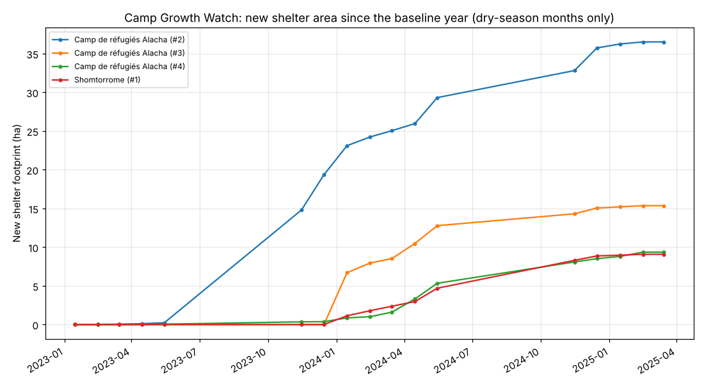
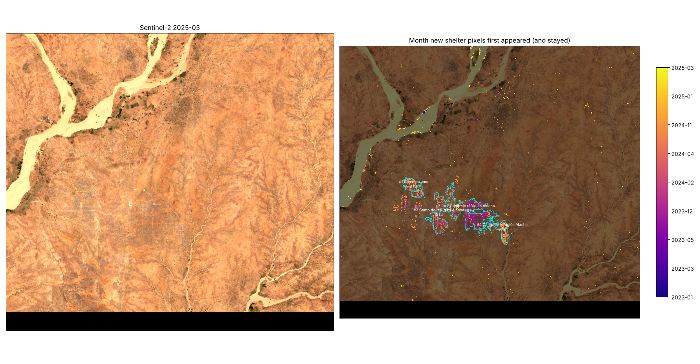

# Camp Growth Watch (`campwatch`) v0.1

Give it a stack of Sentinel-2 images over an area. It finds **where new shelter areas appeared (refugee or displacement camps, informal extensions), the month each part first appeared, and how many hectares each area covered month by month**. Every month is compared with the same calendar month of a baseline year from before the displacement.

It is meant for humanitarian monitoring and documentation: checking that camp extensions show up in planning figures, dating when a site filled, or spotting unplanned sites next to official camps. It measures ground covered by shelters. It does not count people or track anyone.

| Version | File | Status |
|---|---|---|
| Python package + CLI | `campwatch/` (`python -m campwatch`) | Run on real data (Alacha camp, eastern Chad). 4 unit tests |
| QGIS Processing script | `qgis/campwatch_processing.py` | **Run headless in real QGIS 3.34** (`tests/qgis_smoke.py`): `first_seen.tif` identical to the CLI's (0 of 867,486 pixels differ), same 4 areas and 70.3 ha. **Not tried in the QGIS desktop interface or QGIS 4** |
| Google Earth Engine script | `gee/campwatch_gee.js` | Node dry run with a mock `ee` (`tests/gee_dryrun.js`). **Not run in real Earth Engine** |

## Demo: Alacha refugee camp, eastern Chad, 2023 to 2025

Alacha was set up in Ouaddaï for refugees from the war in Sudan. `demo/run_demo.sh` downloads 2021-22 dry-season scenes as the baseline and 2023 to March 2025 dry-season scenes (the 3 clearest per month, 9 x 9 km) from the free AWS bucket, then runs the tool. Those inputs (`demo/data/`, about 465 MB) are not in git.




| Area | Place (Overture) | Footprint by Mar 2025 | First month (10 % of final) | Half reached |
|---|---|---|---|---|
| #2 | Camp de réfugiés Alacha | 36.5 ha | Nov 2023 | Dec 2023 |
| #3 | Camp de réfugiés Alacha (west block) | 15.4 ha | Jan 2024 | Feb 2024 |
| #4 | Camp de réfugiés Alacha (south-east) | 9.4 ha | Feb 2024 | May 2024 |
| #1 | near Shomtorrome | 9.1 ha | Jan 2024 | May 2024 |

Nothing is detected before November 2023. The camp then grows in steps through the 2023-24 and 2024-25 dry seasons and levels off in early 2025. **These dates have not been checked against UNHCR site records.** The true colour image shows a laid-out grid of roads and plots over a wider area than the 70 ha detected. The tool counts the blocks where shelters stand, so it reports less than the planned site; empty plots and the road grid are not counted.

## How it works

1. **Monthly composites.** Each scene is masked with the Sentinel-2 scene classification (clear classes 2, 4, 5, 6, 7) and reduced to three numbers per pixel: blue/red ratio, blue reflectance and NDVI. Scenes in a month are combined by median.
2. **Season.** Only dry-season months are used (default November to May, the Sahel dry season; `--dry-months` changes it). In the rains, green grass raises the blue/red ratio and clouds hide most months.
3. **Like-for-like baseline.** Each month is compared with the same calendar month of the baseline year. Comparing like months removed the spring false alarms that a single January-March baseline gave in testing. The area-wide median change is subtracted as well.
4. **Shelter pixel** = blue/red rose by at least 0.07 AND blue rose by at least 0.015 AND NDVI ≤ 0.30. Plastic sheeting, tents and metal roofs are grey-white on red soil, so a pixel filling with shelters turns less red and brighter in blue. Darker red soil alone raises neither, and green crops are excluded by NDVI.
5. **Persistence.** Each month is smoothed with its neighbours (a majority of 3 months). A pixel's first-seen month is the first shelter month after which it remains shelter in at least half of the later months, so one-off flickers (haze, wet sand) are dropped.
6. **Areas.** New pixels within 2 pixels of each other form one area, and areas under 5 ha are dropped. You can give your own outlines instead (`--units`), such as UNHCR site boundaries or admin units.
7. **Footprint per month** = hectares of an area whose pixels have first appeared by that month. `shelter_ha_this_month` (in the CLI timeseries) is the raw count for that month, before the persistence rule.

### Outputs

| file | content |
|---|---|
| `summary.csv`, `areas.geojson` | one row per area: `footprint_ha`, `first_month` (10 % of final footprint reached), `half_month`, `growth_ha_last3` (footprint gained over the last 3 months used), `observed_pct_last`, `place`, centroid |
| `timeseries.csv` | `unit_id, month, footprint_ha, shelter_ha_this_month, observed_pct` |
| `first_seen.tif` | YYYYMM a pixel became shelter and stayed so (0 = never) |
| `growth.png`, `map.png`, `run.json` | chart, first-seen map, inputs and settings |

## Quick start

```bash
pip install -r requirements.txt
BBOX="21.565 13.035 21.655 13.115"
python -m campwatch fetch-s2 --bbox $BBOX --start 2021-11-01 --end 2022-05-31 --out s2   # baseline year
python -m campwatch fetch-s2 --bbox $BBOX --start 2023-01-01 --end 2025-03-31 --out s2   # period to track
python -m campwatch fetch-places --bbox $BBOX --out places.geojson
python -m campwatch run --scenes 's2/*.tif' --baseline 2021-11 2022-05 --period 2023-01 2025-03 \
  --places places.geojson --out out
```

A whole year of scenes for 10 x 10 km is a few hundred MB. Memory use grows with area × months, so keep each run to a few hundred km². For large regions, run one box per site.

**QGIS:** Processing Toolbox > Scripts > Add Script to Toolbox > `qgis/campwatch_processing.py`. Give the scenes, the baseline and period months as text (`2021-11 2022-05`), and optionally outlines. Its area polygons are raw pixel outlines, without the CLI's smoothing, and it does not add place names.

**Earth Engine:** paste `gee/campwatch_gee.js` and set `AOI`, `BASELINE` and `PERIOD`. It uses `COPERNICUS/S2_SR_HARMONIZED` and charts footprint per area.

## Limits and what is untested

- **Tested on one camp.** Thresholds were set on Alacha. Grey or white shelters on red Sahel soil are the easy case. Shelters made of grass, mud or dark plastic, or camps on pale sand or grey soil, will be weaker or missed. Burned or dismantled camps are not tracked as losses.
- **Dates not checked** against UNHCR records, and footprints not checked against higher-resolution mapping.
- **Underestimates planned sites.** Only blocks where shelters stand are counted, not empty plots or roads, and a block with sparse shelters can stay below the threshold.
- **Dry season only.** Growth during the rains shows up as a jump in November. Change `--dry-months` for other climates; this has not been tried.
- **The baseline year must be free of the camp.** Pick a year before the displacement in the same season.
- Some sand banks along wadis flicker; most are removed by the 5 ha minimum, but check the map.
- QGIS desktop UI, QGIS 4 and real Earth Engine have not been run.

## Files

```
campwatch/core.py            pixel rules, smoothing, first-seen, areas (numpy only)
campwatch/pipeline.py        CLI pipeline (rasterio + geopandas)
campwatch/gdal_run.py        GDAL-only pipeline used by QGIS
campwatch/report.py          growth.png, map.png
campwatch/fetch_s2.py, fetch_overture.py, mgrs.py, names.py   data access (copied from tools/burncheck)
qgis/campwatch_processing.py, gee/campwatch_gee.js
tests/test_core.py, tests/qgis_smoke.py, tests/gee_dryrun.js
demo/run_demo.sh
```
