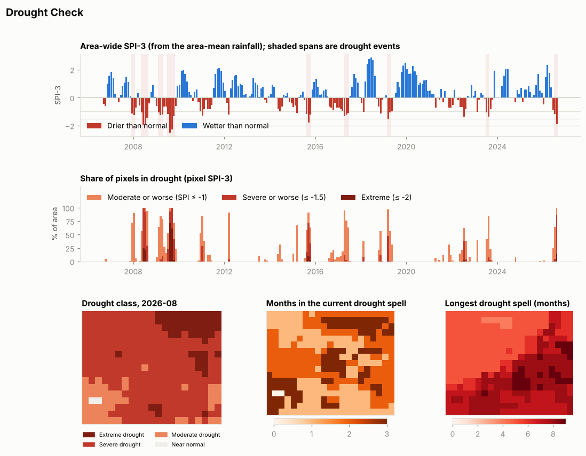
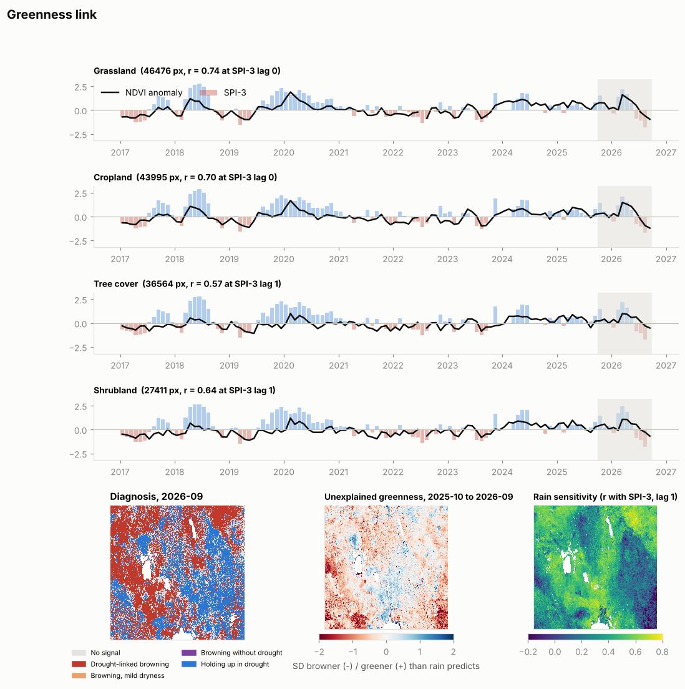

# Drought Check

Drought maps, drought events and a "drought or something else?" check for vegetation, built on CHIRPS rainfall and NASA data. It started from a review of the [`climate-indices`](https://pypi.org/project/climate-indices/) package (NOAA/NCEI lineage, BSD-3) and covers two ideas from that review:

1. **Drought maps and events.** SPI and SPEI per pixel from monthly rainfall, the latest drought class map, the share of the area in drought each month, and drought events found with run theory.
2. **Greenness link.** This pairs a monthly NDVI anomaly with SPI for each land cover class. It shows how strongly greenness follows rain, and it labels each pixel as browning from drought, browning without drought, or holding up in drought. The "browning without drought" pixels are land change candidates.

Like ClassSpectra and Composite Check, it comes in three forms:

- a **Python package and command line** (`droughtcheck/`);
- two **QGIS Processing scripts** (`qgis/droughtcheck_processing.py` and `qgis/greenness_link_processing.py`) that use only what QGIS ships with (GDAL, numpy, scipy);
- a **Google Earth Engine script** (`gee/drought_check.js`) that uses CHIRPS, MODIS NDVI and ESA WorldCover.

## Quick start

```sh
pip install -r requirements.txt
sh demo/run_demo.sh                 # fetches the Nakuru demo data (~80 MB, no logins) and runs both steps
```

Or step by step on your own area:

```sh
# 1. open data, clipped to your area
python -m droughtcheck.fetch chirps --bbox W S E N --start 1981-01 --end 2026-09 --out chirps.tif
python -m droughtcheck.fetch temps  --bbox W S E N --start 1981-01 --end 2026-09 --out power.tif     # for SPEI
python -m droughtcheck.fetch ndvi   --tile x217y076 --start 2017-01 --end 2026-09 --out ndvi.tif     # DE Africa tile
python -m droughtcheck.fetch worldcover --like ndvi.tif --out worldcover.tif

# 2. drought maps and events
python -m droughtcheck drought --precip chirps.tif --temps power.tif --out out/drought

# 3. greenness link
python -m droughtcheck greenness --ndvi ndvi.tif --clear ndvi_clear.tif --drought-dir out/drought \
    --landcover worldcover.tif --legend worldcover --out out/greenness
```

Any monthly rainfall stack works if it has one band per month and band descriptions of the form `YYYY-MM`. TAMSAT, ERA5 and FLDAS rainfall all qualify once written that way. For SPEI you can also pass your own PET stack in mm with `--pet`, for example FLDAS or TerraClimate PET.

## Data sources (all public, no login)

| Input | Source | Notes |
|---|---|---|
| Rainfall | CHIRPS v2.0 monthly, 0.05°, 1981 to present, Digital Earth Africa copy on AWS (`s3://deafrica-input-datasets/rainfall_chirps_monthly`) | Two months (2023-12, 2024-07) are missing from the bucket and also missing as daily files, so indices spanning them are blank. Two other missing months (2022-07, 2024-08) are rebuilt by summing the daily files. |
| Temperature (for SPEI) | NASA POWER, MERRA-2 monthly `T2M_MAX_AVG` / `T2M_MIN_AVG`, 0.5° × 0.625°, from the `nasa-power` Zarr store on AWS | PET is Hargreaves (FAO-56 eq. 52). The grid is coarse, so PET is smooth across a small area. |
| NDVI anomaly | DE Africa `ndvi_anomaly`: monthly Landsat 8/9 + Sentinel-2 NDVI as standard deviations from a 1984–2020 Landsat climatology, 30 m, 2017 onward | Read at the 240 m overview. Values are clipped to ±4. |
| Land cover | ESA WorldCover 2021 v200, majority-aggregated to the NDVI grid | Legends come from ClassSpectra (`classspectra/legends.py`) when it sits next to this folder, so `io` and `dynamicworld` maps work too. |

FLDAS, the NASA catalog (CMR) and the CHIRPS server at UCSB were blocked from the build sandbox. The DE Africa and NASA POWER copies were reachable. In Earth Engine the script reads CHIRPS directly.

## How it works

**SPI** fits a gamma distribution to rainfall summed over 1, 3, 6 or 12 months, separately for each calendar month over 1991–2020, with the McKee probability of zero. **SPEI** fits a generalised logistic distribution (the "log-logistic" of the R SPEI package) to rainfall minus PET, using L-moments. Both use `climate-indices` 3.0 when it is installed. Otherwise they use a built-in version. `tests/test_indices.py` checks that the two agree, and on the demo CHIRPS stack and a synthetic SPEI case they are identical to 1e-6, with the same blank cells.

**Drought classes** follow McKee: −1 is moderate, −1.5 severe and −2 extreme. **Events** use run theory: a spell of at least 2 months below −1, with its duration, magnitude, intensity and peak. Area-wide events use SPI computed from the area-mean rainfall. Per-pixel layers give the number of events, the longest spell, the worst peak, months in drought and the length of the current spell.

**The greenness link** works in four steps.

1. For each class, it correlates the class-mean NDVI anomaly with the class-mean SPI at scales 1, 3 and 6 and lags 0, 1 and 2. It then picks the combination with the best median r across classes.
2. For each pixel, it fits NDVI anomaly against SPI over the baseline, which is every month before the recent window (12 months by default). It then measures how far the recent months fall from that fit. This is the **unexplained greenness**.
3. It diagnoses the target month:

   | Code | Label | Rule |
   |---|---|---|
   | 1 | Drought-linked browning | NDVI anomaly ≤ −1 and SPI ≤ −1 |
   | 2 | Browning without drought | NDVI anomaly ≤ −1 and SPI > −0.5 |
   | 3 | Holding up in drought | SPI ≤ −1 and NDVI anomaly ≥ −0.5 (irrigation, groundwater, deep roots, or a lagged response) |
   | 4 | Browning, mild dryness | NDVI anomaly ≤ −1 and −1 < SPI ≤ −0.5 |

4. It flags a pixel as a **land change candidate** when it has at least 3 "browning without drought" months in the recent window and an unexplained greenness of −1 or less.

## Outputs

`drought` writes:

| File | Content |
|---|---|
| `spi_N.tif`, `spei_N.tif` | One band per month |
| `pet_mm.tif` | Hargreaves PET, when temperatures are given |
| `drought_class_latest.tif` | SPI and class for the last month with data |
| `drought_events.tif` | n_events, longest, worst_peak, worst_magnitude, months_in_drought, current_run |
| `area_timeseries.csv` | Per month: area-mean rain, SPI of the area-mean rain at each scale, % of the area in moderate, severe and extreme drought |
| `events.csv` | Area-wide drought events |
| `report.json`, `report.png` | Findings and the one-page chart |

`greenness` writes `greenness_layers.tif` (r, slope, n_baseline, unexplained_recent, nonclimatic_months_recent, diagnosis_target, landchange_flag), `class_link.csv`, `lag_table.csv`, `class_series.csv`, `greenness.json` and `greenness.png`.

## Demo: Nakuru, Kenya (DE Africa tile x217y076, 35.82–36.81 E, 0–0.75 S)

Results are in `demo/output/`. The NDVI anomaly rasters (`ndvi_anomaly_240m*.tif`, 75 MB) are not in git; `demo/run_demo.sh` downloads them again. CHIRPS covers 1981-01 to 2026-08 and the NDVI anomaly covers 2017-01 to 2026-09.



- **The present:** by August 2026, after a dry June to August (about 55% of normal rainfall), SPI-3 puts 99% of the area in moderate or worse drought. The median SPI is −1.78. The last months of CHIRPS can still be revised, so treat this as provisional.
- **History:** the worst area-wide SPI-3 droughts are 1984 (March to August, peak −2.47), 2000, 2009 and 1993–94. The wet April–May floods of 2018, 2020 and 2024 also stand out.
- **The 2020–23 Horn of Africa drought barely shows up here.** SPI-12 stays above −1 throughout, because that drought hit the drylands of northern and eastern Kenya, not the Rift Valley highlands. A demo over Marsabit or Wajir would show it far more strongly.



| Class | Pixels (240 m) | Best r (SPI-3) | Lag | % pixels rain-sensitive (r > 0.3) | Aug–Sep 2026: drought-linked browning | Holding up in drought | Land change candidates |
|---|---|---|---|---|---|---|---|
| Cropland | 43,995 | 0.70 | 0 | 83% | 62% | 18% | 1.4% |
| Grassland | 46,476 | 0.74 | 0 | 85% | 49% | 27% | 1.3% |
| Shrubland | 27,411 | 0.64 | 1 | 47% | 31% | 47% | 1.5% |
| Tree cover | 36,564 | 0.57 | 1 | 43% | 25% | 56% | 2.3% |

- Grass and crops follow 3-month rainfall in the same month, while trees and shrubs lag by a month and respond less. That matches what you would expect from rooting depth.
- In September 2026, 44% of vegetated pixels show drought-linked browning and none show browning without drought. The current browning is a rainfall story.
- The largest land change clusters are along the western edge (about 0.39 S, 35.85 E) and in the Mau forest block (about 0.68 S, 35.84 E). Another strongly flagged cluster sits on the south shore of Lake Nakuru, where unexplained greenness is −3.6. **These explanations are inferred, not checked:** the Mau clusters fit known forest loss, and the Lake Nakuru one fits the lake's rise since 2020 drowning shoreline woodland. Check them against imagery before using them.

## What has and hasn't been tested

- The **command line** ran on the demo with `climate-indices` 3.0.0 under Python 3.13. Built-in SPI and SPEI match `climate-indices` exactly (`tests/test_indices.py`), Ra matches FAO-56 example 8, and run theory and the diagnosis rules have unit tests.
- The **QGIS scripts** were run outside QGIS with stubbed `qgis` modules (`tests/qgis_smoke.py`) on GDAL 3.8 / Python 3.12 without `climate-indices`, which is like a stock QGIS. They gave the same numbers as the command line, up to float32 rounding. They have never been loaded in a real QGIS.
- The **Earth Engine script** has only had a Node dry run with a stand-in `ee` (`gee/test_gee_mock.js`). That catches JavaScript errors, not Earth Engine ones. It has never run in Earth Engine, and its SPI has not been compared with the Python version. Two details are checked at run time but not verified: the argument order of `gammainc` (the script tests it) and the speed of the per-calendar-month gamma fit over 30 years.
- Not built yet: SPEI in Earth Engine, FLDAS soil moisture, and admin-unit summaries (FEWS NET livelihood zones).
