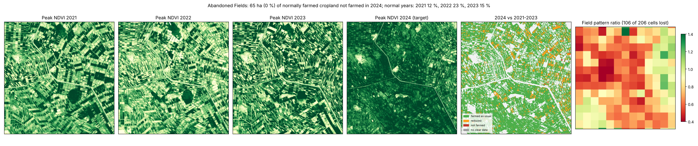
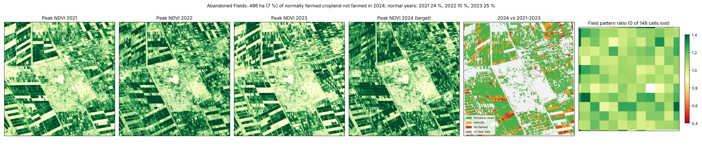

# Abandoned Fields (`fallowcheck`) v0.1

Give it Sentinel-2 images for the same growing season in several years. It reports, per square kilometre or per area you supply, **how much normally farmed cropland was not farmed in the season you are checking**. It also reports **whether the patchwork of separate fields survived**. Each result is compared with what ordinary years look like.

Conflict cuts farming in two ways: people flee or cannot reach their fields, and irrigation schemes stop being managed. Food-security analysts (FEWS NET, WFP, FAO) need these numbers per area, ahead of harvest assessments. The tool measures land, not people.

| Version | File | Status |
|---|---|---|
| Python package + CLI | `fallowcheck/` (`python -m fallowcheck`) | Run on real data (Gezira scheme, Sudan, with a control site). 6 unit tests |
| QGIS Processing script | `qgis/fallowcheck_processing.py` | **Run headless in real QGIS 3.34** (`tests/qgis_smoke.py`): `field_classes.tif` identical to the CLI's (0 of 1,725,010 pixels differ), same 65.0 ha. Its default grid cells line up with the image rather than round coordinates, so per-cell counts differ (99 of 182 cells flagged, against 106 of 206 in the CLI). **Not tried in the QGIS desktop interface or QGIS 4** |
| Google Earth Engine script | `gee/fallowcheck_gee.js` | Node dry run with a mock `ee`. **Not run in real Earth Engine** |

## Two signals, and why both are needed

1. **Not farmed (per pixel).** The season's peak greenness is the 90th percentile of clear NDVI values. A pixel counts as farmed in normal years when its median baseline peak is at least 0.40. It counts as *not farmed* when the target peak is below 0.30 and at least 0.15 lower than that median, and as *reduced* when it dropped by 0.15 but stayed green. Each baseline season is also tested against the other baseline seasons. That gives the normal-year rate, because rotation fallow and crop failure happen every year.
2. **Field pattern (per unit).** The mean of |peak NDVI − its 50 m local mean| measures how much neighbouring fields differ. Farmed land is a patchwork of different crops, sowing dates and fallow, so it scores high. When nobody manages the land, one cover of weeds or grass spreads over everything and the score falls. `pattern_ratio` is the target season's score divided by the baseline median. A unit is `pattern_lost` when that ratio is below 0.8 and more than 0.1 below the lowest ratio any normal year reached.

The Gezira demo shows why the second signal matters. In a wet season, unmanaged fields turn green with weeds, so the peak-greenness rule finds almost nothing.

## Demo: Gezira scheme, Sudan, summer season 2024

Gezira is one of Africa's largest irrigation schemes. The RSF took Wad Madani, its hub, in December 2023, and farming in Al Jazira was widely reported as disrupted in 2024. The demo covers 12 x 12 km of the scheme near Wad Madani, comparing the 15 July to 30 November season of 2024 with 2021–2023. As a control it runs the same test on 10 x 10 km of the **New Halfa scheme** in Kassala state, which saw no fighting in 2024.

| | Gezira 2024 | Gezira normal years (2021 / 22 / 23) | New Halfa 2024 (control) | New Halfa normal years |
|---|---|---|---|---|
| Not farmed (pixel rule) | 0.5 % | 11.6 / 22.8 / 14.7 % | 6.8 % | 23.5 / 10.0 / 24.7 % |
| Cropland with peak NDVI < 0.3 | **0.8 %** | 13.0 / 23.5 / 16.9 % | 9.2 % | 25.8 / 10.8 / 28.7 % |
| Field contrast (mean, cropland) | **0.035** | 0.045 / 0.049 / 0.055 | 0.044 | 0.037 / 0.041 / 0.040 |
| 1 km cells with field pattern lost | **106 of 206** | (normal-year reference) | **0 of 148** | (normal-year reference) |




How to read it: in 2024 the Gezira fields that are normally left bare in rotation (13–24 % of cropland) all turned green, and the boundaries between fields faded. In half of the 1 km cells, the contrast between neighbouring fields fell below anything seen in 2021–2023. In New Halfa the same wet season kept its patchwork; contrast even rose, and no cell lost its pattern. That fits Gezira's fields being left unmanaged and overgrown in 2024, not ordinarily farmed. **It is not proof.** The two schemes differ in water source, crops and rainfall. I have not checked the result against FAO or FEWS NET crop assessments or against field reports, so it needs that check before anyone relies on it.

## Outputs

| file | content |
|---|---|
| `summary.csv`, `units.geojson` | per unit: `farmed_base_ha` (farmed in normal years), `as_usual_ha`, `reduced_ha`, `not_farmed_ha`, `not_farmed_pct`, `normal_year_max_pct` (highest not-farmed share in any normal year), `above_normal`, `pattern_ratio`, `pattern_normal_min`, `pattern_lost`, `observed_pct`, place, centroid |
| `field_classes.tif` | 0 not cropland or not farmed in normal years, 1 as usual, 2 reduced, 3 not farmed, 255 too few clear images |
| `peaks.tif` | peak NDVI per season (one band per year) |
| `run.json` | settings, scene counts, totals, normal-year rates, field contrast and low-peak share per year |
| `map.png` | peaks per season, classes, pattern ratio per cell |

## Quick start

```bash
pip install -r requirements.txt
BBOX="33.38 14.20 33.50 14.32"
python -m fallowcheck fetch-worldcover --bbox $BBOX --out worldcover.tif
for y in 2021 2022 2023 2024; do
  python -m fallowcheck fetch-s2 --bbox $BBOX --start $y-07-15 --end $y-11-30 --out s2
done
python -m fallowcheck run --scenes 's2/*.tif' --baseline-years 2021 2022 2023 --target-year 2024 \
  --season 07-15 11-30 --cropland worldcover.tif --out out
```

`demo/run_demo.sh` runs both demo sites. The Sentinel-2 scenes (about 1 GB per site) are downloaded to `demo/data/` and are not kept in the project folder or in git; WorldCover clips and place names are. The demo's `peaks.tif` outputs (17 and 24 MB) are also left out of git; the run rebuilds them. Use `--units` for admin areas, irrigation blocks or FEWS NET livelihood zones. Pick a season window that fits the local crop calendar: the window must hold each year's peak, and it may cross New Year (e.g. `11-01 03-31` for winter wheat).

**QGIS:** Processing Toolbox > Scripts > Add Script to Toolbox > `qgis/fallowcheck_processing.py`.
**Earth Engine:** paste `gee/fallowcheck_gee.js`; it uses `COPERNICUS/S2_SR_HARMONIZED` and `ESA/WorldCover/v200`. The per-unit normal-year floor is computed in Python only.

## Limits and what is untested

- **One conflict site and one control.** Thresholds and the pattern rule were set by looking at these two schemes. Small rainfed plots (Darfur, Sahel, Tigray), where fields are smaller than a few pixels and fallow is normal, are untested. The pattern signal will be weaker there.
- **Not checked against crop assessments or field reports.**
- **Wet years green unmanaged land.** The pixel rule then undercounts badly, as in Gezira. Read `not_farmed` and `pattern_lost` together, and compare with a nearby unaffected site as in the demo.
- **Drought** also lowers peaks. Check rainfall (e.g. with tools/droughtcheck) before reading a drop as abandonment.
- **Three baseline years** give a rough normal-year range; more years give a better one.
- WorldCover 2021 is the cropland mask; fields opened or abandoned since then are misclassified.
- QGIS desktop UI, QGIS 4 and real Earth Engine have not been run.
