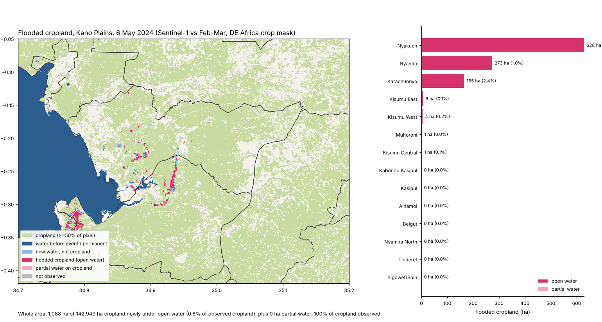

# Flooded Cropland Calculator (`floodcrop`) v0.1

Give it an event date, a cropland map and a set of polygons (admin units or FEWS NET livelihood zones). It returns **hectares of cropland newly under water in each polygon**, compared with a pre-event baseline, plus how much of each polygon's cropland was actually observed.

It is built for NASA **OPERA DSWx** surface-water products (DSWx-HLS from Landsat + Sentinel-2, DSWx-S1 from Sentinel-1). It also runs on Sentinel-1 backscatter, optical reflectance, or any water mask, because DSWx could not be downloaded from the build sandbox (see "What is untested").

Why it is worth having: UN-SPIDER's recommended practice for flooded cropland works at 500 m with MODIS and gives a map, not a table per area. Food-security analysts need a number per admin unit or livelihood zone. This does that at 10–30 m and says how much cropland was hidden by cloud or not imaged.

Three versions share the same rules:

| Version | File | Status |
|---|---|---|
| Python package + CLI | `floodcrop/` (`python -m floodcrop`) | Run on real data (demo below), 13 unit tests |
| QGIS Processing script | `qgis/floodcrop_processing.py` | GDAL-only path run outside QGIS with stubbed `qgis` modules; matches the CLI to 0.0 ha per zone. **Not loaded in real QGIS.** |
| Google Earth Engine script | `gee/floodcrop_gee.js` | Syntax and a Node dry run with a mock `ee` for all three sources. **Not run in real Earth Engine.** |

## How it works

1. **Water per date.** Each input is turned into the same classes: dry, open water, partial water, permanent/masked water, not observed.
   - `dswx`: OPERA DSWx `B01_WTR` (or BWTR) layer: 0 dry, 1 open water, 2 partial, 254 ocean (permanent); 250–253 and 255 are not observed.
   - `sar`: Sentinel-1 VV (linear or dB). A 5×5 mean, then water if VV is below a threshold (Otsu per scene, kept within −22…−15 dB) **or** if it dropped more than 3 dB from the baseline median and is below −14 dB. The drop rule catches shallow water in fields that never gets as dark as a lake.
   - `optical`: 6-band surface reflectance (blue, green, red, NIR, SWIR1, SWIR2) through the five DSWx-HLS / USGS DSWE diagnostic tests with DSWx-HLS default thresholds; high and moderate confidence = water, the two partial classes = partial. Clouds from Sentinel-2 SCL or HLS Fmask.
   - `mask`: any 1/0 water raster (e.g. Digital Earth Africa WOfS).
2. **Combine dates.** Event: water on any observed date (peak extent). Baseline: water on any date counts as "already wet", so seasonal water is never reported as flood. `--*-combine majority` is available.
3. **Flood classes** (`flood_classes.tif`): 1 new open water, 2 new partial water, 3 water before the event or permanent (`--permanent`, e.g. WOfS frequency ≥ 0.8), 255 not observed.
4. **Cropland as a fraction.** The cropland map is averaged from its own resolution onto the water grid, so a 10 m crop mask on a 30 m DSWx pixel counts a two-thirds-cropped pixel as two-thirds. Presets: `worldcover` (class 40), `deafrica` (1), `worldcereal` (100), `binary` (>0).
5. **Hectares per polygon.** Exact pixel areas (ellipsoidal for lat/lon grids). Pixel centres decide which polygon a pixel belongs to.

### Output columns (`summary.csv`, `zones_summary.geojson`)

| column | meaning |
|---|---|
| `flooded_crop_ha` | cropland newly under open water |
| `flooded_crop_partial_ha` | cropland newly under partial water (noisier; reported separately) |
| `flooded_crop_pct` | `flooded_crop_ha` as % of the *observed* cropland |
| `crop_ha`, `crop_observed_pct` | cropland in the polygon, and how much of it the event images saw |
| `flooded_all_ha` | all new open water, any land cover |
| `standing_water_crop_ha` | cropland that was wet before the event too (not counted) |
| `baseline_unobserved_crop_ha` | flooded cropland whose baseline was not observed, so "new" is assumed |
| `observed_pct`, `zone_ha` | coverage and size of the polygon |

Also written: `flood_classes.tif`, `flooded_crop_fraction.tif`, `run.json` (inputs, thresholds actually used, totals) and `map.png`.

## Quick start

```bash
pip install -r requirements.txt
# 1. data for an event (public AWS buckets, no login)
python -m floodcrop.fetch s1        --bbox 34.70 -0.42 35.20 -0.05 --event-date 2024-05-01 --out data
python -m floodcrop.fetch cropland  --bbox 34.70 -0.42 35.20 -0.05 --source deafrica --region eastern --out data
python -m floodcrop.fetch permanent --bbox 34.70 -0.42 35.20 -0.05 --out data
python -m floodcrop.fetch zones     --bbox 34.70 -0.42 35.20 -0.05 --country KE --level county --out data
# (with an Earthdata login:  python -m floodcrop.fetch dswx --product hls|s1 ...)
# 2. run
python -m floodcrop --source sar --event data/s1/S1_VV_20240506.tif \
  --baseline data/s1/S1_VV_20240224.tif data/s1/S1_VV_20240307.tif \
  --cropland data/deafrica_cropmask_2019.tif --crop-preset deafrica \
  --permanent data/wofs_alltime_frequency.tif --zones data/zones_KE_county.geojson --out out
```

With DSWx: `python -m floodcrop --source dswx --event data/dswx/DSWx_HLS_WTR_2024050*.tif --baseline data/dswx/DSWx_HLS_WTR_202403*.tif ...`

`fetch s1` picks the first Sentinel-1 pass on or after the event date and up to three earlier passes **on the same orbit** between 90 and 20 days before (change these with `--baseline-start/--baseline-end`). Sentinel-1 RTC comes from Digital Earth Africa, so it covers Africa only.

**QGIS:** Processing Toolbox › Scripts › Add Script to Toolbox… › `qgis/floodcrop_processing.py`. Keep the `floodcrop/` folder next to the `qgis/` folder (or set `FLOODCROP_PATH`). Needs only what QGIS ships (GDAL, numpy).

**Earth Engine:** paste `gee/floodcrop_gee.js` into the Code Editor, edit the SETTINGS block, run. It uses Sentinel-1 GRD, NASA HLS v002 or your own uploaded DSWx collection, ESA WorldCover, JRC surface water and FAO GAUL level 2 (swap in a FEWS NET livelihood-zone asset).

**Livelihood zones:** `python -m floodcrop.fetch fewsnet --country KE` (untested), or download the shapefile from https://fews.net/data/geographic-boundaries and pass it with `--zones` (needs `pip install fiona`).

## Demo: Kano Plains, Kisumu County, Kenya, long-rains floods of 2024

Late April and early May 2024 floods along the Nyando river and Lake Victoria's Winam Gulf. Area 34.70–35.20°E, 0.42–0.05°S; 14 sub-counties from Overture Maps. Rerun with `python demo/fetch_demo_data.py && bash demo/run_demo.sh`. The Sentinel-1 and Sentinel-2 scenes in `demo/data/s1/` and `demo/data/s2/` (about 310 MB) are not in git; `fetch_demo_data.py` downloads them again.

Inputs: Sentinel-1 RTC (Digital Earth Africa; ascending orbit 130; event 6 May, baseline 24 Feb + 7 Mar), Sentinel-2 L2A (tile 36MYE; event 30 Apr + 10 May, baseline 10 + 15 Feb), DE Africa cropland mask 2019, ESA WorldCover 2021, DE Africa WOfS all-time water frequency.



| Run | Flooded cropland (open water) | Top areas |
|---|---|---|
| 1. Sentinel-1, 6 May, DE Africa crop mask (`output_sar_deafrica`) | **1,088 ha** of 142,949 ha (0.8%) | Nyakach 628 ha (2.2%), Nyando 273 ha (1.0%), Karachuonyo 165 ha (2.4%) |
| 2. Same, WorldCover 2021 cropland (`output_sar_worldcover`) | **280 ha** of 18,697 ha (1.5%) | |
| 3. Sentinel-1, either 24 Apr or 6 May, by county (`output_sar_peak_counties`) | **1,203 ha** | Kisumu 1,025 ha, Homa Bay 177 ha |
| 4. Sentinel-2 with the DSWx-HLS tests, 30 Apr + 10 May (`output_optical_deafrica`) | **1,059 ha** open water, plus 11,007 ha partial water | Nyando 660 ha, Kisumu East 86 ha, Nyakach 47 ha |

What the demo shows:

- **The cropland map matters more than the water method.** WorldCover 2021 marks 18,697 ha of cropland in the area; the DE Africa crop mask marks 142,949 ha. Smallholder fields in western Kenya mostly land in WorldCover's grassland and shrub classes. Flooded-cropland hectares differ by about 4× for the same water map. The tool reports both `crop_ha` and the percentage so this is visible, but which map to trust is a judgement for each country.
- **Sentinel-1 and Sentinel-2 agree on the total, not on where.** Both give about 1,060–1,090 ha. Sentinel-1 puts most of it in Nyakach; Sentinel-2 puts it in Nyando. The dates differ by up to four days and the flood was moving, and neither stand-in is validated, so treat zone-level numbers as indicative.
- **Optical partial water is noisy.** 11,007 ha of "partial water" on cropland includes cloud-shadow edges and dark wet soil that the SCL mask missed. That is why it is a separate column and is not in `flooded_crop_ha`.
- **Sensitivity of the Sentinel-1 result** (`demo/sensitivity.csv`): changing the water threshold (−16, −18 dB), the drop (2, 4 dB) or the smoothing (3, 9 px) keeps the total within 973–1,168 ha. The one setting that moves it a lot is the "dropped pixels must be below" level: −15 dB gives 787 ha (the same as the threshold alone), −13 dB gives 1,386 ha and −12 dB gives 1,626 ha. Shallow water among crops sits around −13 to −16 dB, so this is where local tuning or a real DSWx-S1 product matters.

## What is untested

- **Real OPERA DSWx files.** The decoder follows the DSWx product specs (0/1/2/250–255), but no real DSWx granule has been read. `fetch dswx` (earthaccess search, download, per-date UTM mosaic) has never run: NASA CMR, LP DAAC and PO.DAAC were blocked from the sandbox. Check the WTR value table of the DSWx version you download.
- **FEWS NET.** `fetch fewsnet` uses a FEWS NET Data Warehouse URL that was blocked from the sandbox and may need adjusting. Shapefile zones need `fiona`, which was not tested.
- **Real QGIS and real Earth Engine.** See the table at the top. The GEE script's FAO GAUL default zones are old Kenyan districts, not today's sub-counties.
- **Accuracy.** No comparison with a reference flood map (Copernicus EMS, UNOSAT) yet. The Sentinel-1 rule is a simple threshold-plus-drop; OPERA DSWx-S1 uses a more careful adaptive method with terrain masks. The optical option re-implements the DSWx-HLS tests without DSWx-HLS's terrain, shadow and land-cover masking.
- **Known blind spots.** Flooded vegetation (rice, tall crops) can raise Sentinel-1 backscatter instead of lowering it, so it is missed. Water hidden by cloud is reported as "not observed", not guessed. Cropland maps are 2019 and 2021, not the season of the flood.
- Overture admin names were checked against the 14 Kenyan sub-counties in the demo only; other countries map Overture levels differently.

## Files

```
floodcrop/core.py       numpy-only rules: water decoding, DSWx-HLS tests, SAR rules, combining, flood classes, areas, summaries
floodcrop/io.py         rasterio backend (CLI);  floodcrop/gdal_io.py  GDAL-only backend (QGIS)
floodcrop/pipeline.py   one run; floodcrop/report.py  CSV/GeoJSON/run.json/map.png;  floodcrop/cli.py
floodcrop/fetch.py      downloads: s1, dswx, cropland, permanent, zones, fewsnet
qgis/floodcrop_processing.py   gee/floodcrop_gee.js
demo/fetch_demo_data.py, run_demo.sh, sensitivity.py, data/, output_*/
tests/test_core.py (pytest), tests/qgis_smoke.py (python3 with osgeo), tests/gee_dryrun.js (node)
```

Data sources and licences: Digital Earth Africa products (CC BY 4.0), Copernicus Sentinel data (free and open), ESA WorldCover (CC BY 4.0), Overture Maps divisions (ODbL), OPERA DSWx (NASA, open).
