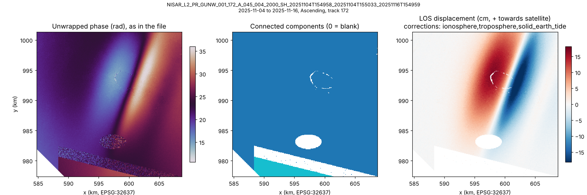

# NISAR GUNW to GeoTIFF

**Turns a NISAR L2 GUNW interferogram (one HDF5 file) into GeoTIFFs you can open in QGIS, including a line-of-sight displacement map in metres with the ionosphere, troposphere and solid Earth tide corrections already subtracted.** This is option 5 from the project's simple-tool shortlist.

NISAR's GUNW product (geocoded unwrapped interferogram) is an HDF5 file with a dozen layers on two grids, plus 3-D "radar grid cubes" for geometry and corrections. NASA Harmony can subset and reformat the GCOV product but not GUNW, and MintPy's `prep_nisar.py` loads GUNW stacks into MintPy's own format for time series. Nothing simple gives you "one interferogram in, GeoTIFFs out", which is what most people want to look at a single earthquake, dike intrusion, landslide or subsidence bowl. That is this tool.

| Form | File | Status |
|---|---|---|
| Python package and command line | `nisargunw/` | Tested on a synthetic GUNW; metadata reading also checked on a real-layout file from JPL's isce3 repo |
| QGIS Processing script | `qgis/nisargunw_processing.py` | Run headless in **QGIS 3.34** (both HDF5 readers); output identical to the command line. **Not run in QGIS 4 or the desktop app** |
| Google Earth Engine | none | **Not built, on purpose.** Earth Engine cannot read HDF5 and does not carry NISAR GUNW, so there is nothing for a script to start from. Convert here, then upload the GeoTIFFs as Earth Engine assets |

## Quick start

```bash
pip install -r requirements.txt
python -m nisargunw inspect NISAR_L2_PR_GUNW_....h5
python -m nisargunw convert NISAR_L2_PR_GUNW_....h5 -o out --dem my_dem.tif --bbox 39.75,8.8,40.05,9.1
```

In QGIS: Processing Toolbox > Scripts > Add Script to Toolbox, pick `qgis/nisargunw_processing.py`, then run **NISAR > NISAR GUNW to GeoTIFF**. Keep the `nisargunw/` folder next to the `qgis/` folder (or set `NISARGUNW_PATH`). QGIS reads the HDF5 through GDAL, so it does not need h5py.

## What a conversion does

1. Reads the identification block (track, frame, direction, dates) and picks frequency A and the first polarization (HH or VV) unless told otherwise.
2. Builds each layer's map grid from its `xCoordinates`/`yCoordinates` (pixel centres, as isce3 writes them) and the EPSG code in its `projection` dataset. With `--bbox` it reads only the window that covers the box, on each grid separately (80 m and 20 m).
3. Writes the file layers you ask for as GeoTIFFs, with fill values turned into nodata.
4. For displacement:
   - **Masks**: keeps pixels with a finite phase, connected component above 0, a valid subswath and no water flag in the product `mask` layer, and (optionally) coherence above `--min-coherence`.
   - **Components**: keeps only the largest connected component by default. Separate components can be a whole number of 2π apart (about 12 cm of LOS at L-band), which a converter cannot fix. `--components all` keeps them and warns.
   - **Corrections**: subtracts the ionosphere phase screen (80 m layer) and the troposphere (wet + hydrostatic) and solid Earth tide phases. The last two come from the radar grid cube, interpolated in x, y and height to each pixel. Heights come from `--dem`, or from a constant `--height` (default 0 m). NISAR does not apply any of these to `unwrappedPhase`; ASF's GUNW page says so.
   - **Units**: LOS = −λ/(4π) × phase, with λ from `centerFrequency` (23.84 cm for NISAR L-band). Positive means motion **towards the satellite**.
   - **Zero point**: interferograms are relative, so the map is zeroed at the median of the largest component (default), the median of all kept pixels, or a point you give with `--ref-lonlat` (pick a spot you know is stable).
5. Optional extras: `vertical_displacement` (LOS ÷ cos(incidence): correct only if the ground moved purely up or down), the ground-to-satellite unit vector (`los_east/north/up`) for combining ascending and descending passes, `incidence_angle`, the `troposphere` and `solid_earth_tide` phases, and `keep_mask`.
6. Writes `<name>_metadata.json` (identification, grids, corrections applied or skipped, reference, components, per-layer statistics, warnings) and a quicklook PNG.

File names start with a short name built from the granule ID: `GUNW_T<track><A|D>_F<frame>_<ref date>_<sec date>_<layer>.tif`.

### Layers

| Name | From | Units |
|---|---|---|
| `unwrapped_phase`, `coherence`, `connected_components`, `ionosphere`, `ionosphere_uncertainty`, `valid_data`, `mask` | `grids/frequencyA/unwrappedInterferogram` (80 m) | rad, 1, label, rad, rad, bits, bits |
| `wrapped_phase`, `wrapped_coherence` | `wrappedInterferogram` (20 m); phase is the angle of the complex value | rad, 1 |
| `along_track_offset`, `slant_range_offset`, `offset_correlation` | `pixelOffsets` | m, m, 1 |
| `los_displacement`, `vertical_displacement` | computed | m |
| `incidence_angle`, `los_east`, `los_north`, `los_up`, `troposphere`, `solid_earth_tide` | radar grid cube at each pixel's height | deg, 1, 1, 1, rad, rad |
| `keep_mask` | computed | 1 = used |

`--layers` takes a comma list, `default` (`los_displacement, unwrapped_phase, coherence, connected_components, incidence_angle`) or `all`.

## Demo: Fentale, Ethiopia (synthetic)

NASA Earthdata (ASF, CMR) can't be reached from the sandbox where this was built, so the demo uses a **synthetic GUNW** made by `demo/make_demo_data.py`. The 16 MB `.h5` is not in git; `demo/run_demo.sh` rebuilds it when it is missing. Its HDF5 layout follows JPL's isce3 GUNW writer (product spec 1.2.1): same paths, dtypes, fill values, attributes, pixel-centre coordinates, per-group `projection` datasets, product `mask` encoding and a radar grid cube on 20 heights. The heights come from the real Copernicus 30 m DEM. **Everything else is invented**: a dike-like deformation shaped after the 2024-25 Fentale-Dofen intrusion in the Main Ethiopian Rift (two uplifted flanks, a trough over the dike, opening across it), plus ionosphere, height-dependent troposphere, solid Earth tide, noise, Lake Beseka as water, an irrigated sugar-cane belt that splits off a second connected component offset by 2π, and a no-data wedge at the frame edge. The dates (2025-11-04 and 2025-11-16, track 172, frame 45) are placeholders.

`demo/run_demo.sh` converts it five ways and compares each displacement map with the deformation that was put in (`demo/compare_truth.py`). Outputs are in `demo/output/`.

| Run | Corrections | Heights | Pixels kept | Error (RMS) | Worst 1% |
|---|---|---|---:|---:|---:|
| 1 recommended | ionosphere, troposphere, tides | DEM | 88% | 3.2 mm | 9.1 mm |
| 2 no corrections | none | — | 88% | 41.5 mm | 94.5 mm |
| 3 corrections without a DEM | all three | constant 0 m | 88% | 9.6 mm | 25.6 mm |
| 4 keep both components | all three | DEM | 91% | 24.3 mm | 120.9 mm |
| 5 clipped to the summit | all three | DEM | 99% | 3.8 mm | 11.7 mm |

"Error" is after removing the constant offset, since each map is zeroed differently. What it shows: the corrections matter (run 2); the troposphere needs real ground heights in a 950-2000 m rift (run 3); and the second component is off by a whole fringe, about 12 cm, which is why the default keeps only the largest one (run 4). Run 1's remaining 3 mm is the noise that was added.



## Real data

`demo/fetch_real_gunw.py` runs on your own computer. It needs a free Earthdata login (in `~/.netrc`) and `pip install earthaccess`. It searches for GUNW granules over Fentale (or any `--bbox`), downloads the first two, and converts them clipped to the box:

```bash
python demo/fetch_real_gunw.py --list-only
python demo/fetch_real_gunw.py --dem my_dem.tif
```

Please send back the `inspect` output and the `*_metadata.json` files: they are what's needed to confirm the points below.

## Where the layout comes from

- isce3 (JPL's InSAR processor that writes NISAR products): `nisar/products/insar/GUNW_writer.py` and `nisar/workflows/h5_prep.py`, read on 2026-10-15. These give the group paths, layer names, dtypes, fill values, the pixel-centre coordinates (`start + 0.5 × spacing`) and the `projection` dataset.
- isce3's test file `tests/data/solid_earth_tides/GUNW.h5`: a real-layout GUNW (spec 1.2.1, made from ALOS data) with the identification block and radar grid cube but no image layers. `inspect` reads it correctly (`tests/test_core.py::test_isce3_fixture_if_given`).
- MintPy `prep_nisar.py`: an independent reader of real GUNW files. It confirms the paths, the `mask` decoding (low byte: hundreds = water, tens = reference subswath, ones = secondary subswath), and that the troposphere and tide cubes are interpolated at DEM height and treated as phase to remove.
- ASF's NISAR GUNW page: unwrapped phase at 80 m, wrapped at 20 m, and the ionosphere, troposphere and tides are **not** applied to the data layers.

## What is untested, and what to check

- **No real NISAR GUNW with image layers has been read.** The demo file follows the isce3 writer, but real products may differ in detail.
- **Sign convention.** The tool assumes the interferogram is reference × conj(secondary), so positive phase is range increase and positive LOS is towards the satellite. That is how isce3 forms it and what MintPy assumes, but the GUNW spec text available here doesn't state it. Check against a known event or GNSS. `--flip-sign` reverses it.
- **Correction signs.** Each correction phase is *subtracted*, as MintPy does. If a real product stores them with the opposite sign, run 2 vs run 1 on real data will look worse instead of better.
- **Pixel centres.** isce3 writes centre coordinates, but the spec says the rasters are tagged "pixel-is-area". If outputs look shifted by half a pixel (40 m) against a reference, this is why.
- **Connected component fill value.** isce3 now writes 65535 (uint16 max); an older spec draft says 255. The tool reads `_FillValue` from the file, so either works if the attribute is there.
- **DEM heights** are used as heights above the ellipsoid. Copernicus DEM heights are above the geoid (EGM2008), off by up to tens of metres in Africa. In the demo that changes the troposphere by under a millimetre, so it is ignored.
- **Frequency B, polar stereographic grids, quad-pol** are coded for but never exercised.
- **Memory**: without `--bbox`, `wrapped_phase` reads a whole 20 m frame (about 12,000 × 12,000 complex values, over 1 GB). Use `--bbox` for 20 m layers.
- **QGIS 4 and the QGIS desktop app**: only tested headless in QGIS 3.34.
- **The Earthdata collection names** in `fetch_real_gunw.py` are a best guess from catalogue page names.
- GeoTIFFs are written without internal overviews (QGIS builds pyramids when asked). In the project's shared folder, TIFFs with overviews were later rewritten by something outside the tool and broke, so they were dropped.

## Tests

```bash
python -m pytest tests                       # grids, windows, cube interpolation, mask bits, sign, referencing, demo vs truth
ISCE3_GUNW=/path/to/isce3/tests/data/solid_earth_tides/GUNW.h5 python -m pytest tests
QT_QPA_PLATFORM=offscreen python3 tests/qgis_smoke.py /tmp/out   # with a Python that has QGIS
NISARGUNW_READER=gdal ...                    # force the GDAL reader (what QGIS uses without h5py)
```

The GDAL-reader test runs only where GDAL's Python bindings exist. In the sandbox all 9 tests passed across Python 3.13 (rasterio) and 3.12 (QGIS/GDAL).

## Files

```
nisargunw/product.py    HDF5 paths, layers, units, mask decoding, wavelength
nisargunw/readers.py    h5py reader and GDAL multidimensional reader, same interface
nisargunw/core.py       grids, windows, radar-cube interpolation, phase to metres, referencing (numpy only)
nisargunw/convert.py    one file end to end; metadata JSON
nisargunw/rio_io.py     rasterio/pyproj output, DEM resampling (command line)
nisargunw/gdal_io.py    the same with GDAL only (QGIS)
nisargunw/quicklook.py  PNG overview
nisargunw/cli.py        inspect / convert
qgis/                   Processing script
demo/                   synthetic data maker, run script, truth comparison, real-data script, outputs
tests/                  pytest suite and the headless QGIS test
```

The demo DEM (`demo/data/dem_fentale.tif`) is cut from the Copernicus GLO-30 DEM (© DLR e.V. 2010-2014 and © Airbus Defence and Space GmbH 2014-2018, provided under COPERNICUS by the European Union and ESA).

## Possible next steps

- Batch a frame's worth of pairs into one GeoTIFF stack with dates in the band names, for quick time series in QGIS's temporal controller.
- Combine an ascending and a descending GUNW into east-west and vertical motion (the `los_*` vectors are already written for this).
- Also convert the L1 RUNW (radar geometry) product once it matters.
